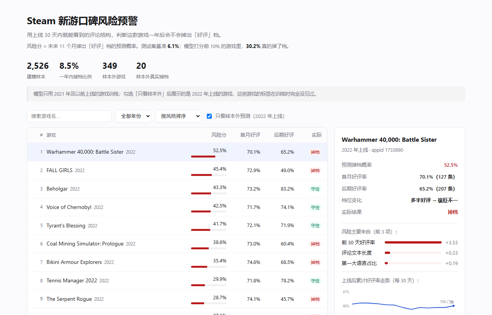

# Steam 新游口碑风险预警

**用上线 30 天内就能看到的评论结构，判断这款游戏在第 30–365 天会不会掉出「好评」档。**



`2,526 款游戏` · `215 个降档案例` · `AUC 0.886`（滚动 7 折中位 0.861）· `复核 22% 抓到 68/85 个降档`

> 同一个模型、同一批特征，只把标签窗口切开，结论就从"不需要模型"（增量 +0.003）变成"有边际价值"（+0.014）。
> 这个项目真正想讲的是**标签定义如何决定模型有没有存在价值**，不是"我训了个模型"。

**怎么快速看完**：结论看 [§1](#1-三个结论按重要性排序) · 方法看 [§4](#4-方法) · 怎么跑看 [§11](#11-复现) · 业务落地看 [业务一页纸](docs/业务落地一页纸.md)

---

## 1. 三个结论，按重要性排序

### 1.1 标签口径决定模型有没有存在价值

同一批游戏、同一批特征，只改标签的窗口定义，结论从"不需要模型"变成"模型有边际价值"：

| 标签口径 | 单特征 `early_ratio` | 全特征 LogReg | 模型增量 |
|---|---|---|---|
| 旧：全量评论（观察期 366–4,765 天浮动） | 0.900 | 0.901 | **+0.001** |
| 中：365 天累计（早期窗口包含在标签里） | **0.926** | 0.929 | **+0.003** |
| 新：只看第 30–365 天（与特征窗不重叠） | 0.872 | **0.886** | **+0.014** |

中间一行看起来最漂亮（AUC 0.929），其实最没有价值：**早期好评率本身就是标签的一部分**，模型只是把它重述了一遍。把窗口切开后，任务变难了（0.926 → 0.872），但模型终于有了独立贡献（+0.003 → +0.014）。

这是本项目唯一一个我认为值得写进简历的判断。

### 1.2 好评率极高时，什么特征都不重要

按早期好评率三分组，看不同评论量下的降档率：

| 早期好评率 | 10–100 条 | 100–400 条 | 400+ 条 |
|---|---|---|---|
| 低（均值 0.791） | **29.9%** | 20.3% | 12.4% |
| 中（均值 0.908） | 5.5% | 1.4% | 0.0% |
| 高（均值 0.975） | 1.1% | 0.0% | 0.0% |

高好评率组几乎不可能降档，评论量完全无关。**评论量的保护作用只发生在临界游戏上**——也就是好评率在 0.70–0.80 之间、随时可能跌破阈值的那批。这比"评论多就安全"准确得多。

### 1.3 降档是一个可以提前 11 个月看到的风险

| 模型 | AUC | 95% CI | AP | P@10% | lift | ECE |
|---|---|---|---|---|---|---|
| 常数基线（全猜基准率） | 0.500 | — | 0.061 | 6.1% | 1.0 | 0.054 |
| 单特征 `early_ratio` | 0.872 | — | 0.327 | 28.8% | 4.7 | — |
| **全特征 LogReg** | **0.886** | [0.86, 0.91] | **0.343** | **30.2%** | **5.0** | **0.050** → 校正后 **0.022** |
| 全特征 RandomForest | 0.866 | [0.83, 0.90] | 0.319 | 30.9% | 5.1 | 0.046 |
| *滚动切分 7 折（中位）* | *0.861* | *0.846–0.911* | — | — | — | — |

**P@10% 30.2% 的含义**：模型打分最高的 140 款游戏里，42 款真的掉了档；随机抽是 8.5 款。这是这个项目唯一可以直接换成业务动作的数字——"每季度人工复核 140 款高风险游戏"。

---

## 2. 问题与业务语境

发行商或独立开发者在**上线 30 天**这个节点要做三个决定：是否追加市场投放、是否投入本地化、是否启动口碑修复。这三件事都取决于一个判断——**这款游戏接下来会变好还是变差**。

现有的做法是看好评率。但好评率 75% 的两款游戏，一款是在 60 条评论上得到的 75%，一款是在 3,000 条评论上得到的 75%，风险完全不同。这个项目就是在量化这个差别。

**为什么不做"预测最终评价好不好"**：那是另一个问题，且答案太容易——直接看首发好评率就够，模型没有空间（见 §1.1 第一行）。

---

## 3. 数据

| 数据 | 来源 | 规模 | 用途 |
|---|---|---|---|
| 评论 | HuggingFace [`adde023/steam-reviews`](https://huggingface.co/datasets/adde023/steam-reviews) | 1.139 亿条，665 个 parquet 分片 | 全部特征与标签 |
| 元数据 | HuggingFace [`FronkonGames/steam-games-dataset`](https://huggingface.co/datasets/FronkonGames/steam-games-dataset) | 12.4 万款游戏，192 MB | 发行日期（用于校准"首条评论 ≈ 上线日"） |

**本次使用的分片**：`part.{0, 3, 6, …, 663}`，共 222 个（221 个成功）。分片按 `appid` 升序排列，取步长 3 相当于覆盖全部游戏的约三分之一，共聚合出 **35,487 款游戏**。

单条评论的字段（`ajaxappreviews` 与数据集一致）：

```json
{
  "appid": 1145360, "game": "Hades",
  "timestamp_created": 1600000000, "voted_up": true,
  "author_playtime_at_review": 1234, "author_num_games_owned": 210,
  "language": "english", "review": "…"
}
```

### 样本筛选漏斗

| 步骤 | 剔除 | 剩余 |
|---|---|---|
| 聚合游戏 | — | 35,487 |
| 排除跨分片脏数据（appid 730，评论被切到多个 part） | −1 | 35,486 |
| 首月评论 < 10 条（好评率不可信） | −22,828 | 12,658 |
| 365 天内评论 < 100 条（档位判不出） | −7,196 | 5,462 |
| 观察窗不完整（`t0 + 365d > 数据快照`） | −792 | 4,670 |
| 开局档位不是好评（问题不适用） | −834 | 3,836 |
| 第 30–365 天评论 < 50 条 | −192 | 3,644 |
| 无发行日期 / 首条评论与发行日相差 > 30 天 | −1,118 | **2,526** |

最终 **2,526 款游戏，215 个降档（8.5%）**。

---

## 4. 方法

### 4.1 时间口径

```
t0            = 该游戏在本数据集里的首条评论时间（≈ 上线日，与发行日的中位偏差 0 天）
特征窗口      = [t0, t0 + 30d]         ← 所有特征只能看这一段
标签窗口      = [t0 + 30d, t0 + 365d]  ← 只用来打标签，与特征窗口零重叠
数据快照      = 2023-11-02             ← 只保留 t0 + 365d ≤ 快照的游戏
```

**为什么不用"全部评论"**：旧做法下观察期从 366 天到 4,765 天不等，降档率随之单调上升（3.4% → 5.2% → 8.2% → 14.0%）。标签里混进了"被观察了多久"，模型学到的最强信号会变成游戏年龄。

### 4.2 标签

```
早期档位 = tier(前 30 天好评率, 前 30 天评论数)
后期档位 = tier(第 30–365 天好评率, 该区间评论数)

is_drop = (早期档位 ∈ 好评档) AND (后期档位 ∉ 好评档)
```

档位用 Steam 官方口径（好评如潮 ≥95%@500、特别好评 ≥80%@50、好评 ≥80%、多半好评 ≥70%、褒贬不一 40–70%…）。好评档 = 前四档。

### 4.3 特征（全部来自前 30 天）

| 特征 | 说明 |
|---|---|
| `early_ratio` | 前 30 天好评率（最强单特征） |
| `log_n_early` | 前 30 天评论量（对数） |
| `log_n_7` | 首周评论量 |
| `share_7day` | 首周评论占首月比例 |
| `decay_ratio` | 首月 / 首周评论倍数（>1 表示首月后仍在获得评论） |
| `playtime_h` / `playtime_p90_h` | 早期评论者的游戏时长（中位 / P90） |
| `log_numgames` | 评论者账号拥有游戏数（对数） |
| `lang_top_share` / `lang_n` | 第一大语言占比 / 语言种类数 |
| `rlen_med` | 评论文本长度中位 |
| `nonzero_playtime_share` | 有时长记录的比例（0 = 可能没真玩） |

**结构性防泄漏**：`aggregate.py` 里所有特征函数只接收 `off ≤ 30d` 的子集，函数拿不到窗口外的数据。`check.py` 另外断言特征名与全量统计列（`n_all` / `up_all` / `t_max` / `final_*`）无交集。

### 4.4 切分与评估

- **时间切分**：≤2018 训练（1,128 款，130 正例，11.5%），2019–2022 测试（1,398 款，85 正例，6.1%）
- **主指标**：AP / PR-AUC（正例 8.5%，accuracy 无意义），辅以 AUC、P@10%、lift、ECE
- **不做超参搜索**：130 个训练正例，调参就是在拟合噪声。模型容量固定，报告的是"在这套特征上能做到多少"

---

## 5. 消融：增量到底来自哪里

| 特征组 | AUC | AP | P@10% |
|---|---|---|---|
| A. 仅好评率 | 0.872 | 0.327 | 28.8% |
| B. 好评率 + 评论量 | 0.884 | 0.295 | 29.5% |
| C. 去掉好评率（只剩数量与人群） | 0.674 | 0.112 | 15.1% |
| D. 去掉评论量（质量 + 人群） | 0.885 | 0.346 | 30.2% |
| E. 全特征 | 0.886 | 0.343 | 30.2% |

两个读法：

- **C 的 0.674 是这套数据里最值钱的反证**：把最强的特征拿掉，评论量和人群结构仍然显著优于随机。说明模型不是在复述好评率。
- **D ≈ E 说明评论量的边际贡献很小**（0.885 → 0.886）。这与 §1.2 的分层结果一致：评论量只在临界游戏上起作用，而那部分样本占比不高。

---

## 6. 连续目标：换个问法

把"会不会掉"换成"会掉几个点"，用 Ridge 回归预测 `后期好评率 − 早期好评率`，全部 2,526 个样本都参与（不再只有 8.5% 的正例）：

| 指标 | 值 |
|---|---|
| Spearman（测试集） | 0.309 |
| MAE | 3.3 个百分点 |
| 阈值化为二分类后的 AUC | 0.714 |

排序能力明显弱于二分类（0.886）。原因是：二分类只关心"是否跨过档位阈值"，而回归要预测具体幅度，噪声大得多。**这本身说明"档位是否跨越阈值"比"好评率变化多少"更可预测**——因为阈值是离散的、由平台规则固定的。

---

## 7. 我做错的三件事

写在这里，因为它们是这个项目里最有信息量的部分。

### 7.1 特征用了未来信息（AUC 0.866 → 0.821）

第一版把 `playtime_med`、`numgames_med`、`lang_top_share` 算成了**全部评论**的中位数，7 个特征里 5 个含未来信息。修正后 AUC 掉到 0.821。

这类错误不会报错，只会静默给出好看的数字。现在的防线是 `check.py` 的断言 + `aggregate.py` 的窗口参数强制。

### 7.2 `class_weight='balanced'` 破坏了概率校准（ECE 0.253 → 0.050）

为了处理 8.5% 的不平衡，最初用了 `class_weight="balanced"`。它确实让类别权重平衡了，但代价是输出的"概率"被强行拉到 50% 附近：

| 设置 | AUC | AP | ECE | 平均预测 | 实际 |
|---|---|---|---|---|---|
| `balanced` | 0.886 | 0.317 | **0.253** | 0.314 | 0.061 |
| 无权重 | **0.886** | **0.343** | **0.050** | 0.110 | 0.061 |

**AUC 完全相同，但概率差了 5 倍。** 不平衡问题应该用 AP / P@K 评估，而不是用重加权去污染概率输出。

### 7.3 一个被推翻的旧结论

早期版本得出"评论量是缓冲垫，10–50 条组降档率是 1000+ 条组的 4.8 倍"。换成不重叠标签后，这个倍数降到 3.0×，并且在控制好评率后只在临界组显著（§1.2）。**原结论里有一部分是估计噪声**：评论少的游戏，档位估计不稳，本来就更易跨阈值。

---

## 8. 跨年基准率漂移：诊断与处理

### 8.1 现象

训练段（≤2018）降档率 **11.5%**，测试段（2019–2022）只有 **6.1%**。差了将近一倍。

### 8.2 成因：不是测量噪声，是真实变化

三种机制都会造成同样的表象，逐个排除：

| 假设 | 检验 | 结论 |
|---|---|---|
| H2 测量变化（后来评论更多，档位估计更稳，偶然跨阈值变少） | 后期评论数中位：2018 年 183 → 2022 年 167，**基本没变**；控制评论量分层后两段差距仍在（−1.4 到 −8.1pp） | ❌ 排除 |
| H3 样本结构变化（临界游戏占比变了） | 临界游戏（首月好评率 70–80%）占比 23.4% → 16.9%，有下降但幅度不足以解释一半的落差 | ⚠️ 次要 |
| **H1 真实行为变化** | 好评率变化均值从 **−3.3pp 收窄到 −1.1pp**，后期好评率均值从 0.845 升到 0.870 | ✅ 主因 |

**结论：后来的游戏确实更少掉档。** 变化集中在 2019–2020 之间，是一次**断点**而不是渐变——2019 年还有 8.5%，2020 年直接掉到 5.5%，之后稳定在 5% 附近。

### 8.3 影响：只影响绝对水平，不影响排序

| 年份 | 实际 | 未校正预测 | 偏差 | ECE |
|---|---|---|---|---|
| 2019 | 8.5% | 11.6% | +3.2pp | 0.032 |
| 2020 | 5.5% | 11.5% | +6.0pp | 0.061 |
| 2021 | 5.1% | 10.8% | +5.7pp | 0.057 |
| 2022 | 5.7% | 10.3% | +4.6pp | 0.046 |

**真正麻烦的不是 ECE，是固定阈值下的命中率**：

| 阈值 | 2016 命中率 | 2018 命中率 | 2020 命中率 | 2022 命中率 |
|---|---|---|---|---|
| p ≥ 10% | 38.2% | 34.4% | **15.0%** | **16.7%** |
| p ≥ 20% | 51.1% | 50.0% | **21.6%** | **24.2%** |

同一个阈值，在 2018 年有一半是对的，到 2020 年只剩两成。**如果按固定概率阈值报警，误报率会翻倍而使用者不会察觉。**

### 8.4 处理：用上一年已观测的基准率做先验校正

关键观察：**给第 y 年的游戏打分时，第 y−1 年这批游戏的 365 天窗口已经关闭，它的降档率是完全可观测的。** 所以目标先验不需要猜，查上一年的实际值即可。

做法是只平移 logit 的截距（Saerens 等 2002 的先验校正）：

```
logit(p') = logit(p) + log(π_target / (1−π_target)) − log(π_train / (1−π_train))
```

**单调变换，同一年内的排序严格不变。**

| 方案 | 测试段 ECE | 2022 偏差 | 可部署 |
|---|---|---|---|
| 不处理 | 0.050 | +4.6pp | — |
| 用当年真实率（天花板） | 0.007 | +0.2pp | ❌ 需要未来标签 |
| **用上一年率（采用）** | **0.022** | **−0.3pp** | ✅ |

**ECE 降 56%，年内排序不变，合并 AUC 0.886 → 0.885。**

先验规则做过五种比较（`src/train.py: lagged_prior`）：一年只有 300–400 款游戏，单年率很噪，直觉上应该用滑动均值；但实测 **y−1 反而最好**，因为这个漂移是断点不是渐变，平滑规则会在台阶处拖后腿（用 last2 预测 2020 时先验 10.5%，实际只有 5.5%，比不校正还差）。

**代价写清楚**：断点当年（2019、2020）依然会高估 3–4 个百分点。任何滞后先验都做不到更好——事件发生前无从得知。

### 8.5 顺带排除的一个方案

按时间给训练样本加权（半衰期 4 年 / 2 年）：

| 权重 | 测试 AUC | 测试 ECE |
|---|---|---|
| 不加权 | 0.886 | 0.050 |
| 半衰期 4 年 | 0.885 | 0.051 |
| 半衰期 2 年 | 0.884 | 0.053 |

**没有任何改善。** 说明漂移在截距上，不在系数上——也就是"特征与风险的关系"没变，变的只是"基准发生率"。这正好支持先验校正而不是重新训练。

## 9. 稳健性：0.886 是运气吗

单次时间切分只给出一个点。滚动切分把它变成一条分布：**每个 origin 只用过去预测下一年**，共 7 折。

| origin → 测试年 | 训练样本/正例 | 测试样本/正例 | 基准率 | AUC | AP |
|---|---|---|---|---|---|
| 2015 → 2016 | 499 / 49 | 214 / 34 | 15.9% | 0.846 | 0.504 |
| 2016 → 2017 | 713 / 83 | 206 / 21 | 10.2% | 0.861 | 0.422 |
| 2017 → 2018 | 919 / 104 | 209 / 26 | 12.4% | 0.858 | 0.529 |
| 2018 → 2019 | 1,128 / 130 | 295 / 25 | 8.5% | 0.911 | 0.504 |
| 2019 → 2020 | 1,423 / 155 | 383 / 21 | 5.5% | 0.850 | 0.306 |
| 2020 → 2021 | 1,806 / 176 | 371 / 19 | 5.1% | 0.878 | 0.196 |
| 2021 → 2022 | 2,177 / 195 | 349 / 20 | 5.7% | 0.909 | 0.504 |

**AUC 中位 0.861，范围 0.846–0.911，极差 0.066。**

三句话读这张表：

1. **0.886 是可信的**，但不是中心——7 折中位数是 0.861。主结果用 0.886（它的测试集最大、置信区间最窄），同时必须披露滚动中位是 0.861。
2. **AP 波动远大于 AUC**（0.196–0.529），因为基准率在变。AP 只在同一基准率下可比，跨年不能直接比。
3. **没有一折掉到 0.8 以下**，说明 0.886 不是某个切点碰巧撞上的。

### 9.1 门槛敏感性

`n_late ≥ 50` 是拍定的门槛。取三档重跑：

| 门槛 | 训练/正例 | 测试/正例 | 基准率 | AUC | AP |
|---|---|---|---|---|---|
| ≥ 30 | 1,152 / 137 | 1,456 / 105 | 7.2% | 0.883 | 0.359 |
| **≥ 50（主口径）** | 1,128 / 130 | 1,398 / 85 | 6.1% | **0.886** | 0.343 |
| ≥ 100 | 893 / 79 | 1,064 / 49 | 4.6% | 0.898 | 0.292 |

**AUC 极差 0.015**，远小于 0.05 的判定线。门槛影响样本量与基准率，不影响区分能力。可以写进局限，不影响主结论。

### 9.2 决策曲线：什么成本结构下值得用

AUC 不能直接回答"该不该用"。决策曲线（net benefit）把它换成决策语言：

```
NB(p_t) = TP/N − FP/N × p_t/(1 − p_t)
```

`p_t` 同时是"决策阈值"和"**一条误报值多少条漏报**"的折算比例——在 p_t = 10% 处行动，等于认为一条误报的代价是漏报的 1/9。

| 决策阈值 | 复核比例 | 命中率 | 抓到正例 | 模型净收益 | 全部复核净收益 | 每百款净增 |
|---|---|---|---|---|---|---|
| 5% | 33.0% | 16.3% | 75/85 | 0.0391 | 0.0114 | **+2.77** |
| 8% | 26.2% | 19.1% | 70/85 | 0.0317 | −0.0209 | **+3.17** |
| **10%** | **21.9%** | **22.2%** | **68/85** | **0.0297** | −0.0436 | **+2.97** |
| 15% | 16.2% | 26.4% | 60/85 | 0.0218 | −0.1049 | +2.18 |
| 20% | 13.0% | 28.6% | 52/85 | 0.0139 | −0.1740 | +1.39 |
| 25% | 10.2% | 32.2% | 46/85 | 0.0098 | −0.2523 | +0.98 |
| 30% | 8.1% | 31.0% | 35/85 | 0.0011 | −0.3417 | +0.11 |
| 40% | 5.4% | 31.6% | 24/85 | −0.0076 | −0.5653 | −0.76 |

**结论**：只要一条漏报的代价大于约 3 条误报（p_t ≤ 25%），用模型就优于"全部复核"；p_t 超过 30% 后模型不再产生净收益，此时应该扩大复核范围而不是依赖排序。

**最优操作点在 p_t = 8–10%**：复核约 22% 的游戏，抓到 68/85 个降档案例，每百款净增约 3 个净值单位。

## 10. 局限（读结论前请先看这一节）

1. **评论不等于销量**。全程只能说"口碑"和"关注度"，不能说"卖得好不好"。
2. **只覆盖 PC Steam**，且只覆盖本数据集里评论量达标的游戏（35,487 → 2,526，筛掉 93%）。结论不能外推到小体量游戏。
3. **数据止于 2023-11**，2024 年后发行的游戏完全不在样本内。
4. **不估计因果**。模型说的是"会怎样"，不是"做了 X 会怎样"。
5. **跨年基准率漂移已处理但不彻底**：用上一年基准率做先验校正后，ECE 从 0.050 降到 0.022；但断点当年（2019、2020）仍会高估 3–4 个百分点。
6. **标签只到第 365 天**。第 2 年、第 3 年的变化未建模。

---

## 11. 复现

```bash
pip install -r requirements.txt
python run_all.py            # 增量跑：聚合 → 标签 → 审计 → 建模 → 导出
python run_all.py --refresh  # 强制重新聚合全部 222 个分片（约 12 分钟）
```

产物：

```
out/labels.parquet       2,526 行样本（含三种标签口径）
out/metrics.json         全部指标（三种标签 + 消融 + 回归）
out/predictions.json     2,526 款游戏的风险分与归因
site/index.html          可直接双击打开（数据内联在 data.js）
```

依赖：`pandas` / `numpy` / `pyarrow` / `scikit-learn`，以及能访问 HuggingFace 的网络。

**验收自检**：`src/check.py` 会对"特征无泄漏 / 窗口完整 / 计数单调 / 标签与前缀一致 / 切分不重叠"逐条断言，跑不过直接退出。

---

## 12. 目录

```
steam-risk/
├── config.py              全部口径常量（窗口、阈值、排除名单）
├── run_all.py             一条命令跑完整条链路
├── src/
│   ├── aggregate.py       分片 → 游戏级窗口统计（一次扫描算所有窗口）
│   ├── label.py           三种标签口径 + 筛选漏斗 + 新旧对照
│   ├── features.py        特征构造 + 消融分组
│   ├── check.py           方法论审计（断言）
│   ├── train.py           时间切分 / 消融 / 校准 / 回归 / 漂移校正
│   ├── drift.py           漂移诊断与三种处理方案的对比实验
│   ├── robustness.py      滚动切分 / 门槛敏感性 / 决策曲线
│   └── export.py          导出 JSON + 归因
├── data/windows/          222 个分片的聚合结果
├── out/                   样本、指标、预测
└── site/                  单页前端（无后端、无 CDN）
```
